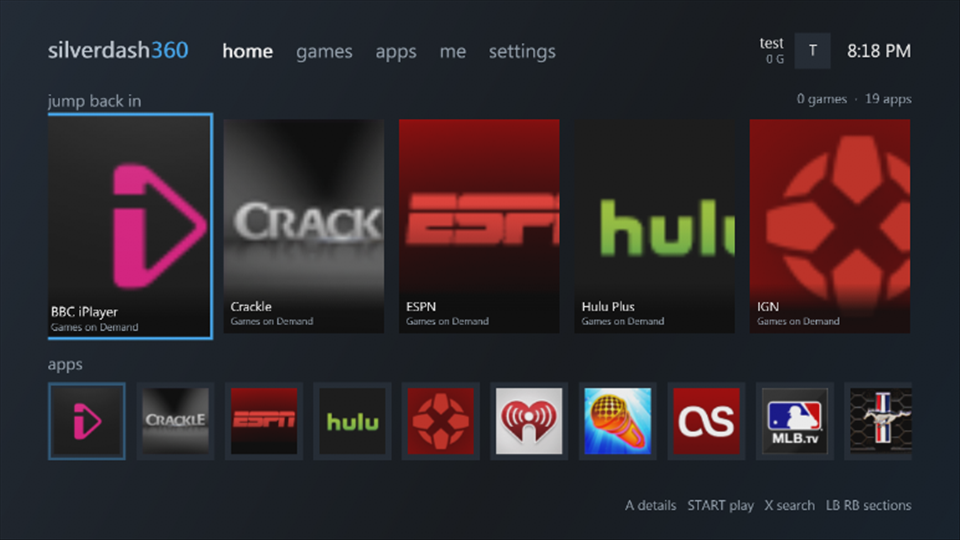
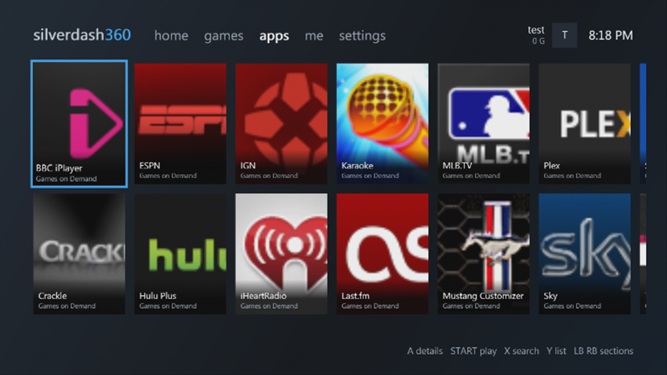
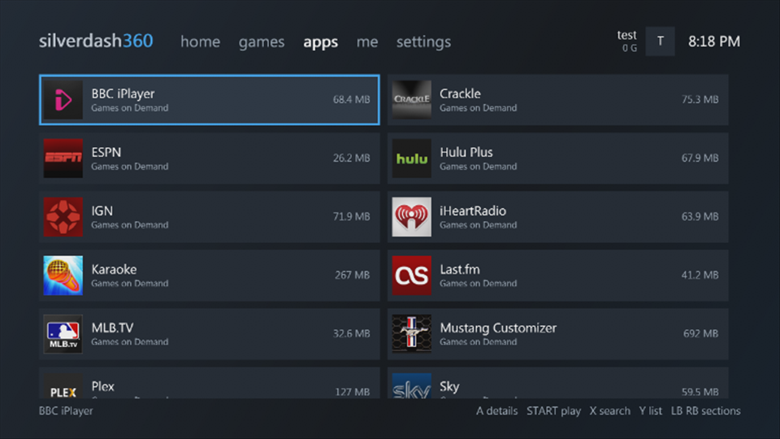
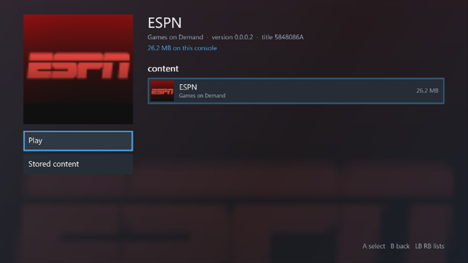
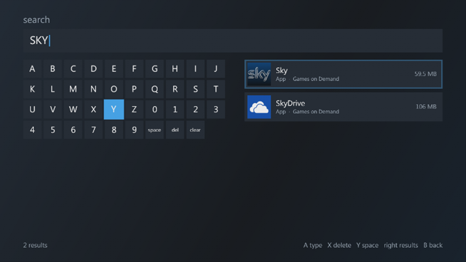
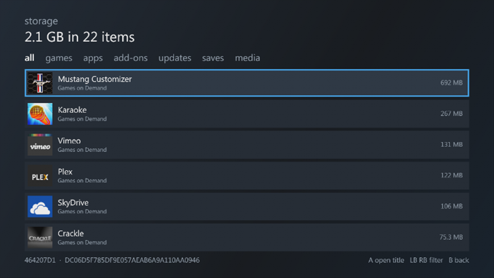
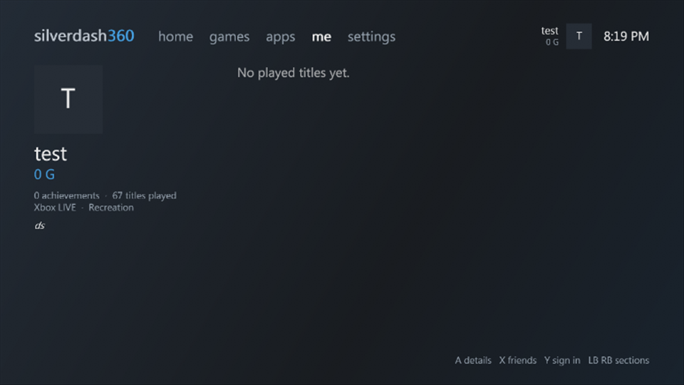
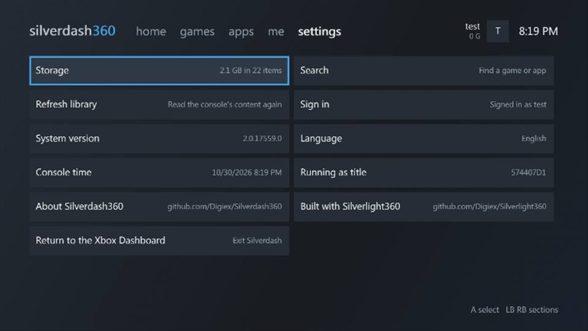

# Silverdash360

A custom Xbox 360 dashboard written in C# with [Silverlight360](https://github.com/Digiex/Silverlight360). It lists the games and apps on the console the way the console's own dashboard does, and starts them.

| | |
|---|---|
|  |  |
| Home: recently played and the apps | A shelf of covers, two rows that scroll sideways |
|  |  |
| The same shelf as a list, with sizes and progress | A title's details, stored content and achievements |
|  |  |
| Search as you type | Everything stored, largest first, by kind |
|  |  |
| The signed-in profile and its played titles | Console information and system actions |

The screenshots are from xenia-edge with a test set of app packages.

## Features

- **Games and apps** from the console's storage, with the art, names, publisher, description and version in each package's header. Apps are told from games by title ID.
- **Cover and list views** (Y switches). The views only make tiles for what's on screen, so large libraries stay fast.
- **Title details**: what's stored for the title (the game, title updates, add-ons, saves) with sizes, and the profile's achievements for it.
- **Search** with an on-screen keyboard, by name, publisher or title ID, updating as you type.
- **Profile**: gamertag, gamer picture, gamerscore, motto and zone, and the titles played with their achievement progress.
- **Storage**: everything stored, largest first, filtered by games, apps, add-ons, title updates, saves and media.
- **Settings**: system version, language, console time, sign-in, refreshing the library and returning to the Xbox Dashboard.
- **Launching**: Play on a title's page, or Start on a title in the hub.

## Controls

| Button | |
|---|---|
| D-pad, left stick | Move |
| A | Open, select |
| B | Back |
| Start | Play the title selected in the hub |
| X | Search; friends on the profile; delete on the keyboard |
| Y | Cover or list view; sign in on the profile; space on the keyboard |
| LB, RB | Switch sections (and tabs and filters on other pages) |

Moving past the left or right end of a section switches to the next one too.

## Building

You need what the Silverlight360 SDK needs (see its [getting started guide](https://github.com/Digiex/Silverlight360/blob/master/docs/getting-started.md)), including a runtime profile. Then:

```powershell
.\tools\Build.ps1 -Sdk path\to\Silverlight360
```

`-Sdk` can be left out when the `SILVERLIGHT360` environment variable points to the SDK, or when it's cloned next to this repository as `Silverlight360`. The package lands in `src\Silverdash360\bin\Release\xbox\`.

The package runs as the title the SDK's runtime profile came from (Plex by default), so it's started like that app.

## Running in xenia-edge

```powershell
.\tools\Run.ps1 -Steps '16:shot' -Seconds 20
```

`-ContentRoot` gives xenia a content folder of its own, so the dashboard can be tried on a known set of packages without touching xenia's (see [Testing in xenia](https://github.com/Digiex/Silverlight360/blob/master/docs/testing.md)). The dashboard needs the XAM functions below, which xenia-edge doesn't have yet; they're on the `pr-dashboard-content` branch, to be proposed to xenia-edge.

| Function | What the dashboard uses it for |
|---|---|
| `XamContentAggregateCreateEnumerator` | Every package of every title, as the console's dashboard lists them |
| `XamContentGetMetaDataInternal` | A package header's names, description and art |
| `XamContentLaunchImageInternalEx` | Starting a package |

The dashboard writes what it does to xenia's log as `(DbgPrint) [Silverdash] ...`.

## How it works

Everything is C#. The console's own functions are called with `DllImport` by ordinal, with structures passed as pinned big-endian buffers.

```
src/Silverdash360/
  Native/     DllImports into xam.xex and xboxkrnl.exe, and NativeBuffer for structures
  Model/      ContentItem (one package), ContentMetadata (its header), TitleEntry, Gamer, ...
  Services/   Library, IContentSource, ProfileService, ImageService, SystemService, classifiers
  Controls/   TileGrid (the virtualized grid), tile templates, OnScreenKeyboard, Theme
  Modules/    The hub's sections and the registry they're listed in
  Pages/      Hub, title details, search, storage
```

The library is read the way the console's dashboard reads it:

1. **Content**: one `XamContentAggregateCreateEnumerator` over every title and type, for common content and for the signed-in profile, returning 0x200-byte `XCONTENT_DATA_INTERNAL` records.
2. **Metadata**: `XamContentGetMetaDataInternal` per package, for names, description, publisher, version, size and thumbnails.
3. **Profile**: `XamUserGetSigninInfo`, `XamUserReadProfileSettings` for the gamer card, `XamUserCreateTitlesPlayedEnumerator` and `XamUserCreateAchievementEnumerator`, and `XamReadTile` for game tiles and gamer pictures.
4. **Launching**: `XamContentLaunchImageInternalEx` with the package's record, after checking it isn't partly downloaded or damaged.

All of it runs on a background thread, and images are decoded on the UI thread and cached.

## Extending it

- **A new hub section**: implement `IDashboardModule` (or derive from `DashboardModule`) and add it to `ModuleRegistry`, or call `ModuleRegistry.Register` before the hub is shown. A section gives a view, a header, an order and a legend, and hands the D-pad's left and right edges to the hub with `ForwardEdges`.
- **Telling more apps from games**: add an `ITitleClassifier` to `Library.Classifiers`. Classifiers are asked in order and the first answer wins.
- **Another content source**: implement `IContentSource`, for example to list packages from a network share, and pass it to `Library`.
- **A new view of titles**: `TileGrid` takes any `ITileTemplate`. `RowTemplate` makes rows from a `RowData` description, and `CoverTileTemplate` makes covers.

## Limitations

- Tested under xenia-edge only, not on a console.
- Xbox LIVE features (Marketplace, friends, messages) open the console's own screens, which xenia doesn't implement.
- The profile's played titles are the ones with achievements, as the console lists them; apps without achievements don't appear there.
- Disc games aren't listed until they're played or installed.

## License

Silverdash360 is licensed under the PolyForm Noncommercial License 1.0.0, with an additional condition: projects made with it must reference this repository. See [LICENSE.md](LICENSE.md).

It's built with [Silverlight360](https://github.com/Digiex/Silverlight360), which has its own license.

## Trademarks

Xbox, Xbox 360, Xbox LIVE and Silverlight are trademarks of the Microsoft group of companies. Plex and the names and art of other apps shown in the screenshots belong to their owners. Silverdash360 isn't affiliated with or endorsed by any of them.
