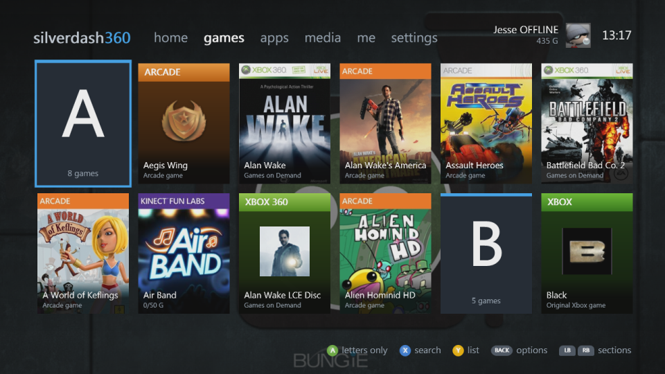
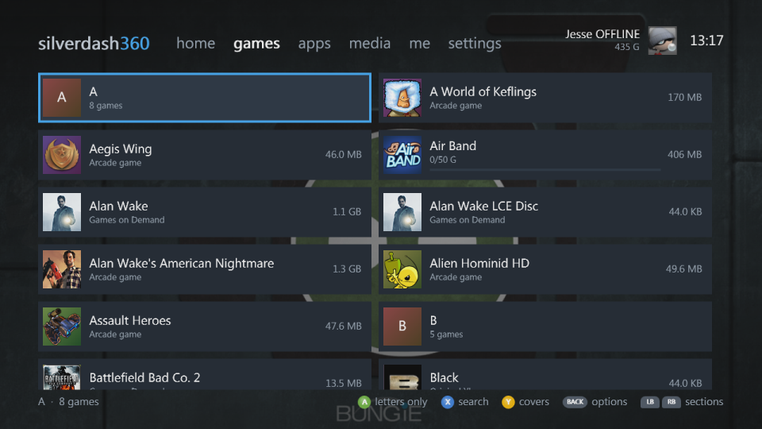
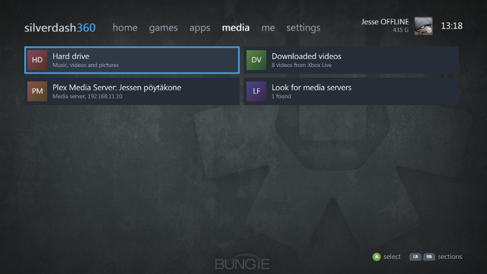
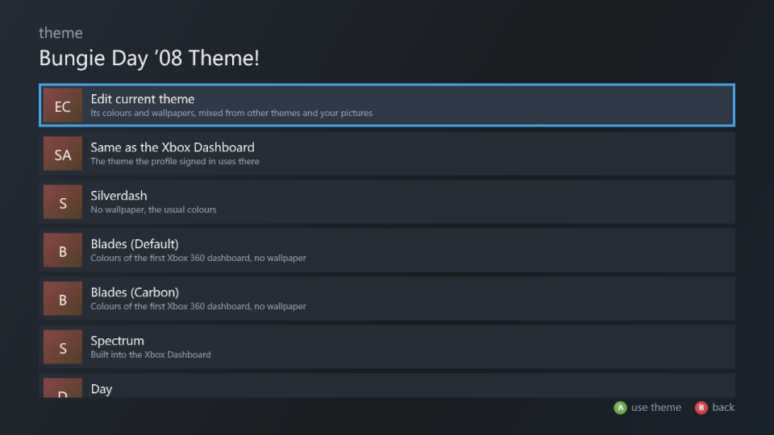

# Silverdash360

A dashboard for the Xbox 360. It lists the games and apps on your console, with their box art, and starts them; plays your music, videos and pictures from the console's drives and from media servers on your network; and shares the console's drives over FTP. It runs on the console's own Silverlight platform, built with [Silverlight360](https://github.com/Digiex/Silverlight360).

**[Documentation](https://digiex.github.io/Silverdash360/)** · **[Download](https://github.com/Digiex/Silverdash360/releases/latest)** · **[Digiex](https://digiex.net)**

| | |
|---|---|
|  |  |
| Home: recently played and the apps | A shelf of covers, with a letter heading each letter |
|  |  |
| The same shelf as a list | A title's details and achievements |
|  |  |
| The drives, media servers and downloaded videos | Themes, and a theme editor of your own |

## Features

- **Games and apps** from the hard drive and USB drives: Games on Demand, Arcade, Indie, demos, original Xbox games and homebrew in `Apps` and `Games` folders, with box art and store details from the Xbox Marketplace, kept for offline use.
- **Jump back in** with the titles you played last, and the disc in the drive first.
- **Covers or a list**, sorted and filtered as you like, with letters to jump through a long shelf.
- **Media**: music, videos and pictures from the drives, data discs and DLNA media servers such as Plex, and the videos you downloaded from Xbox LIVE.
- **Your profile**, gamerscore and achievements. Each profile has its own saves, theme and played titles, and it works with nobody signed in too.
- **Themes**: the console dashboard's themes with their wallpapers, its built-in Spectrum, Day and Night, the first dashboard's Blades colours, and a theme editor to mix your own.
- **Search**, **storage**, a **file browser** and an **FTP server**.
- **Updates itself** when there's a new version.

## Installing

You need an Xbox 360 that runs homebrew (RGH or JTAG).

1. Download the base package from the [Silverdash360 thread on Digiex](https://digiex.net/threads/silverdash360-homebrew-xbox-360-dashboard.20103/) and extract it.
2. Download the [latest release](https://github.com/Digiex/Silverdash360/releases/latest) and extract its files over the base package's `Silverdash360` folder, replacing what's there.
3. Copy the `Silverdash360` folder to the console, such as to `Hdd1:\Apps\Silverdash360`.
4. Start its `default.xex`.

The [installation guide](https://digiex.github.io/Silverdash360/install/) has each step. After that, Silverdash360 offers each new version itself.

## Controls

| Button | |
|---|---|
| D-pad, left stick | Move |
| A | Play on home; open or select elsewhere |
| B | Back |
| START | A title's details on home |
| X | Search; your friends on me |
| Y | Open or close the disc tray on home; covers or a list on the shelves; sign in on me |
| BACK | A shelf's options |
| LB, RB | Switch sections at once |
| Left, right at a section's end | The next section, after a short pause |
| LT, RT | A screen back or forward |

More in the [documentation](https://digiex.github.io/Silverdash360/getting-around/).

## Problems and ideas

[Report a problem](https://github.com/Digiex/Silverdash360/issues/new?template=bug_report.yml) or [request a feature](https://github.com/Digiex/Silverdash360/issues/new?template=feature_request.yml) on GitHub Issues; look through the [open issues](https://github.com/Digiex/Silverdash360/issues) first. [Problems and ideas](https://digiex.github.io/Silverdash360/issues/) says what helps. For questions and chat, there's the [Silverdash360 thread on Digiex](https://digiex.net/threads/silverdash360-homebrew-xbox-360-dashboard.20103/).

## Contributing

Contributions and pull requests are welcome. See [CONTRIBUTING.md](CONTRIBUTING.md) for how, and [Development](docs/development.md) for building and testing.

## Building it yourself

See [Development](docs/development.md): building with Silverlight360, the debug server and tests, releases and how it works.

## License

Silverdash360 is licensed under the PolyForm Noncommercial License 1.0.0, with an additional condition: projects made with it must reference this repository. See [LICENSE.md](LICENSE.md).

It's built with [Silverlight360](https://github.com/Digiex/Silverlight360), which has its own license.

## Trademarks

Xbox, Xbox 360, Xbox LIVE and Silverlight are trademarks of the Microsoft group of companies. Plex, Bungie and the names and art of the other games, apps and themes shown in the screenshots belong to their owners. Silverdash360 isn't affiliated with or endorsed by any of them.
