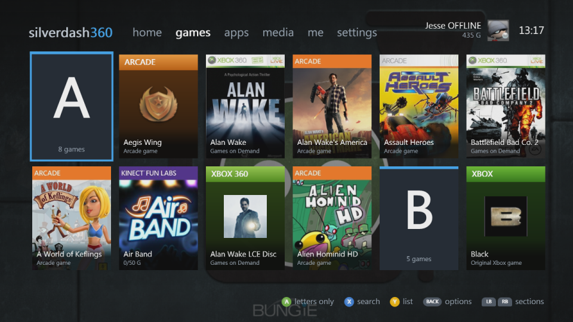
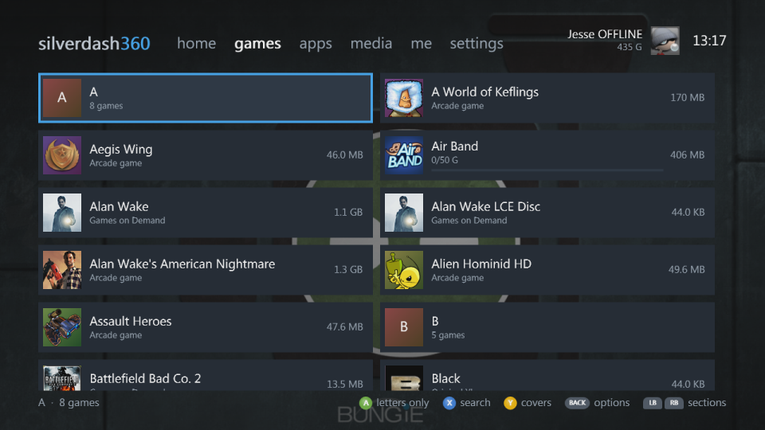
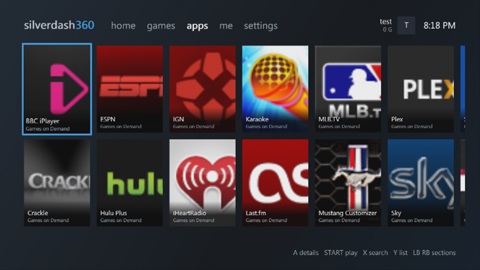
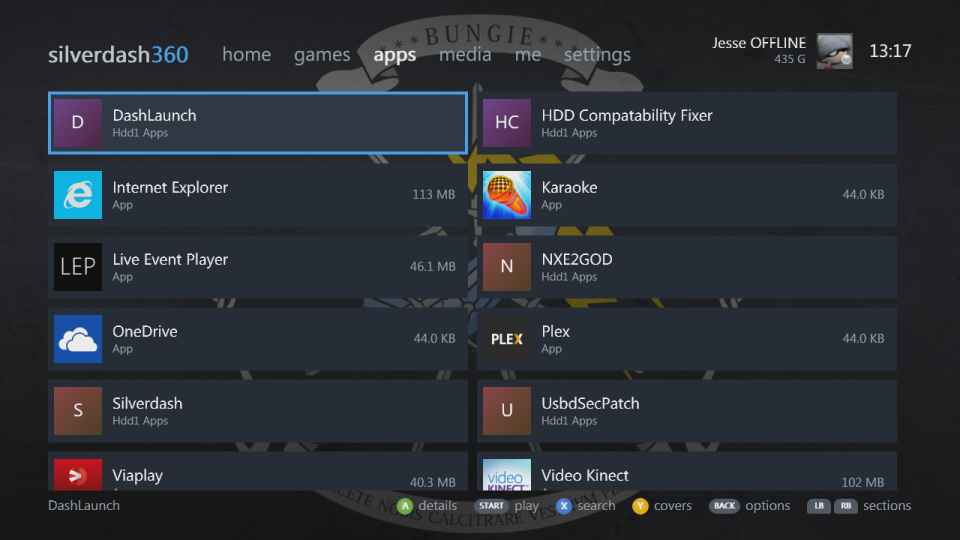
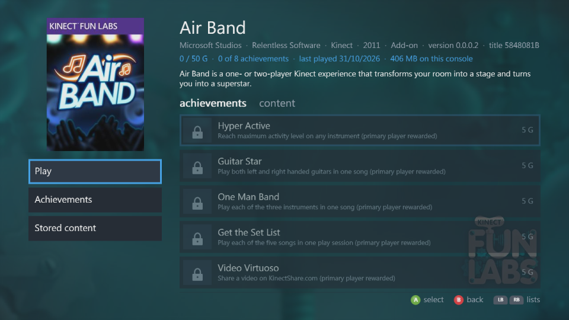
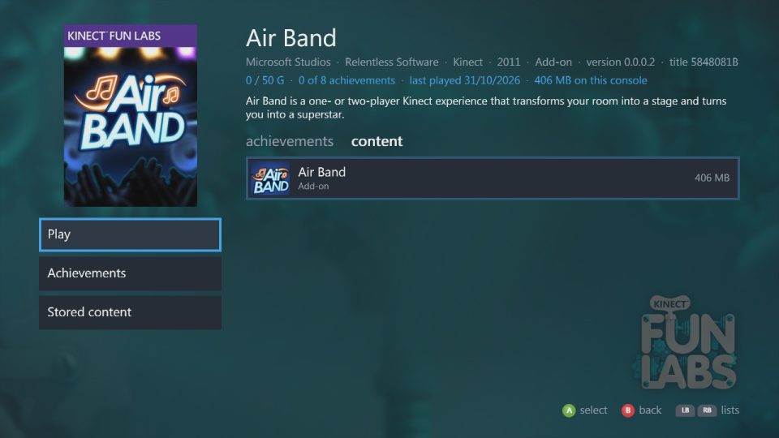

# Games and apps

The **games** and **apps** sections are shelves of everything installed on the console's hard drive and USB drives. Each title has its box art from [x360db](https://github.com/xenia-manager/x360db), an archive of the Xbox Marketplace's art, or else from the Xbox Marketplace itself, where the console's own dashboard gets it, or the package's own picture.

**Xbox Dashboard** is always among the apps: it starts the console's own dashboard from its flash memory. It starts that dashboard even where Silverdash360 is set up as the default one, as with DashLaunch, which leaving for the default dashboard wouldn't.

| | |
|---|---|
|  |  |
|  |  |

## What's listed

- **Xbox 360 games**: installed discs, Games on Demand and Arcade, Indie and XNA games and demos.
- **Original Xbox games**, each one its own title.
- **Apps**, such as media apps, told apart from games by their title ID.
- **Homebrew**: a `default.xex` in each folder of a drive's `Apps` and `Games` folders (`Hdd1`, `Usb0` to `Usb2`), and `.xex` files right in `Apps`. A folder of `Apps` without a `default.xex` starts from the `.xex` named after the folder, such as `Aurora\Aurora.xex`, or else from its only `.xex`; one with several and none named after it isn't listed. Each is named after its folder, unless a package or your profile names it, or you name it with [your own art](#your-own-art-and-details).
- **Executables you added** in the [file browser](settings.md#file-browser) with Y, wherever they are, on the shelf you picked: **Games** or **Apps**. One already in `Apps` or `Games` moves to the shelf you picked. A `default.xex` is named after its folder, another `.xex` after itself, and either can have [your own art](#your-own-art-and-details) beside it.
- **QuickBoot shortcuts** show as the app or game they start; a shortcut and the folder it starts are listed once.
- **Titles with nothing to start**, such as a game with only saves or add-ons left, are hidden until you show them with the shelf's options.

Silverdash360 keeps what it read, so it starts quickly. At a start it shows the library it saved and looks only for what starts games and apps, and for themes, as they come and go; a title's add-ons, updates and saves are listed again when you open its page. **Refresh library** in settings reads everything again.

Box art and store details are downloaded in the background and kept in the `Data\Art` folder, so they're there without the internet afterwards. The box art, background, banner and tile come from x360db first, unless they're kept from the Marketplace already, and an original Xbox game's box art that x360db doesn't have from [xdb](https://github.com/xemu-project/xdb). The store details, the description, genre, developer, publisher and release date, come from x360db too, or from the Marketplace for a title x360db hasn't got; screenshots come from the Marketplace. A title neither knows gets a cover of its kind with its icon or its initials.

## Your own art and details

A game or app kept as a folder, a `default.xex` (or an app's own `.xex`, such as `Aurora.xex`) in a folder of `Apps` or `Games`, can have art, a name and a description of your own. Make a folder named `Silverdash360Art` beside its `.xex`, laid out as a title's folder in [x360db](https://github.com/xenia-manager/x360db/tree/main/titles) is:

```
Hdd1\Games\Some Game\
    default.xex
    Silverdash360Art\
        info.json
        artwork\
            boxart.jpg
            background.jpg
            icon.png
```

| File | What it is | Size |
|---|---|---|
| `artwork\boxart.jpg` | The box front on the title's page | 219 by 300 (or that shape) |
| `artwork\background.jpg` | The backdrop behind the title's page | 1280 by 720 |
| `artwork\icon.png` | The tile on the shelves | 64 by 64 or larger, square |
| `info.json` | The name, description, publisher, developer, genre and release date | |

Every file is optional, and the images can be right in `Silverdash360Art` instead of in `artwork`. Images are JPEG or PNG, up to 8 MB each. A title's folder from x360db can be copied in as it is: its `info.json` and `artwork` folder are what Silverdash360 reads.

`info.json` is x360db's: only `title` is needed, and anything else can be left out.

```json
{
    "title": { "full": "Some Game" },
    "description": { "full": "What the game is about." },
    "publisher": "Someone",
    "developer": "Someone",
    "genre": [ "Platformer" ],
    "release_date": "2024-05-01"
}
```

What's in `Silverdash360Art` comes before anything downloaded and before the name and description the game's files give. Silverdash360 only reads the folder, and the game never looks in it, so it doesn't get in the way of the game's own files. A new name shows once the library is read again, at the next start or with **Refresh library**; art shows the next time the title is shown.

## Covers and lists

Y switches a shelf between covers, two rows that scroll sideways, and a list with sizes and achievement progress. LT and RT move a screen at a time.

A shelf sorted by name and long enough has a letter tile heading each letter's titles. A on a letter shows the letters alone, to jump through the shelf; A on a letter again shows everything, with that letter where it was.

## The shelf's options

BACK on a shelf opens its options. A changes a setting, X steps it back, and B is done; the shelf follows at once and keeps them:

| Option | |
|---|---|
| **Show** | Installed titles (the default), a kind (Xbox 360 games, Arcade, Indie and XNA, Demos, Original Xbox, Homebrew), the titles not installed, or everything |
| **Stored on** | A drive, or all of them |
| **Sort by** | Name, size or last played |
| **View** | Covers or a list |
| **A button** | Whether A plays a title or shows its details; START does the other |

## A title's details

A title's page has its backdrop, the store's description, developer, genre and release date, and two lists that LB and RB switch between: **achievements**, your progress in it, when you're signed in and have played it, and **content**, what's stored for it (the game, title updates, add-ons, saves) with sizes. **Play** starts it, with **Play from disc** when its disc is in the drive and a **Play disc** for each disc of a game with several, and a **Play version** for each older version of a game kept beside its newest, as arcade games can have; **Achievements** and **Stored content** go to the lists. A title without achievements, such as an original Xbox game or an app, has no achievements list.

**Rename** gives the title a name of your own with the console's keyboard, which the shelves, search and its page show from then on, in place of any other. **Use its own name** puts back the name it had. The names are kept in `Data
ames.txt`.

| | |
|---|---|
|  |  |

## Discs

A disc in the drive comes first in jump back in, with a little disc on its cover. A game disc starts; a disc of files opens in media; a DVD movie, audio CD or original Xbox disc plays in the console's own player. For a game with several discs, its page has a **Play disc** for each. Y on home opens and closes the tray.
