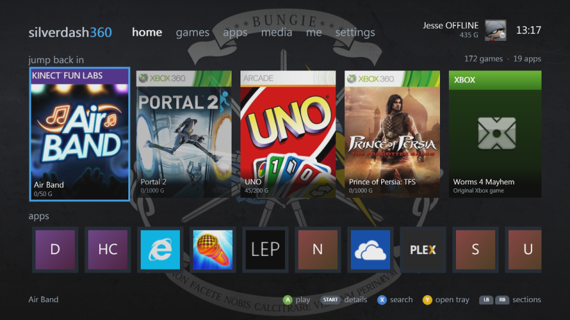
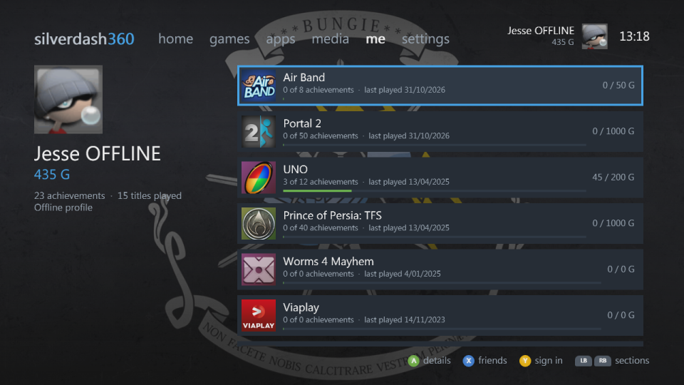
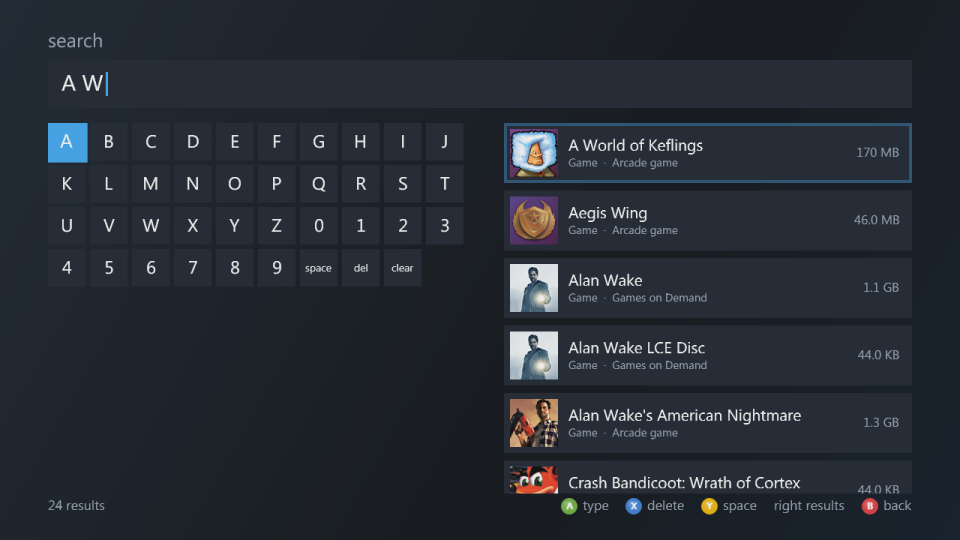

# Getting around

Silverdash360 has six sections across the top: **home**, **games**, **apps**, **media**, **me** and **settings**. LB and RB go from one to the next at once, and round from settings to home. Moving past the left or right end of a section goes to the next one too, but only as a move of its own: holding the D-pad or the stick, or pressing it again and again to run through a shelf, stops at the shelf's end, and a press after a short pause goes on. The bar at the bottom says what the buttons do where you are.

## Controls

| Button | |
|---|---|
| D-pad, left stick | Move |
| A | Play on home; open or select elsewhere. On the games and apps shelves, the shelf's options choose whether A plays or shows a title's details |
| B | Back |
| START | The other of A: a title's details on home; on the shelves, play or details, whichever A isn't |
| X | Search; your friends on me |
| Y | Open or close the disc tray on home; switch between covers and a list on the shelves; sign in on me |
| BACK | The shelf's options on the games and apps shelves |
| LB, RB | Switch sections, and lists and filters on other pages |
| LT, RT | A screen back or forward on the shelves |

## Home

**Jump back in** has the titles you played last, with the disc in the drive first. A starts a title, and START shows its details. Below it, **apps** has the apps installed. Y opens and closes the disc tray.

## Me

Your gamertag, gamer picture, gamerscore, motto and zone, and the titles you've played with your progress in each. A shows a title's details, X your friends, and Y signs in, or signs in another profile.

Silverdash360 works with nobody signed in: the games, apps and media are the console's. Signing in or out, here or from the Guide, shows that profile's saves, theme and played titles straight away, without reading the whole console again. Each profile keeps its own, and so does nobody signed in.

## Search

X opens search from home and the shelves. Type with the on-screen keyboard (A types, X deletes, Y adds a space), and the results update as you type: titles by name, publisher or title ID. Move right to the results.

## When things are busy

Silverdash360 puts what you do first: box art, wallpapers and reading the drives wait while you move, and catch up when you stop. A section you haven't opened yet is drawn once you stop on it.
