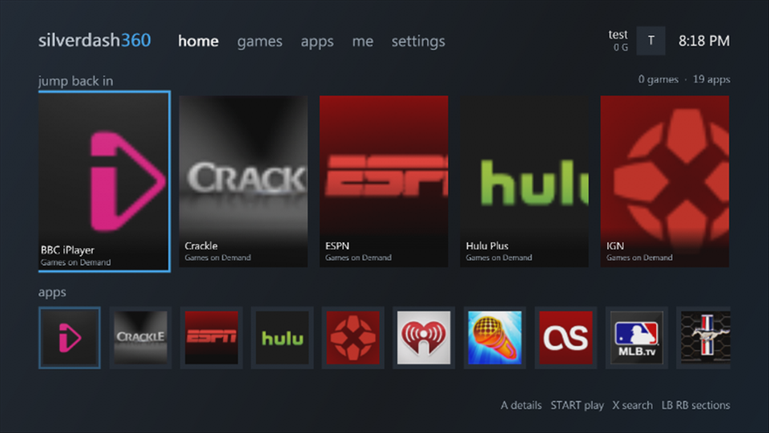
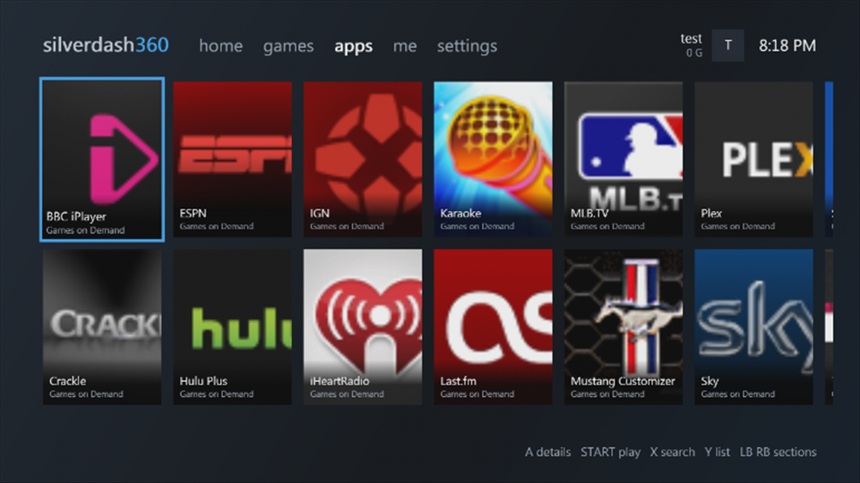
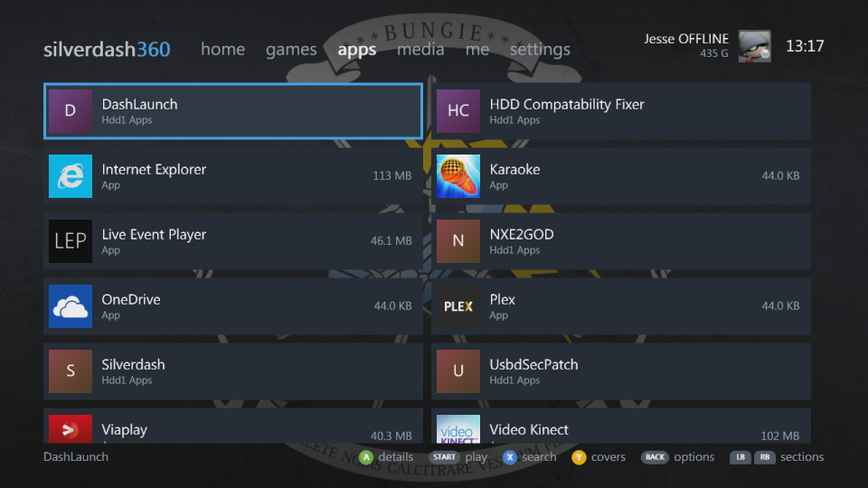
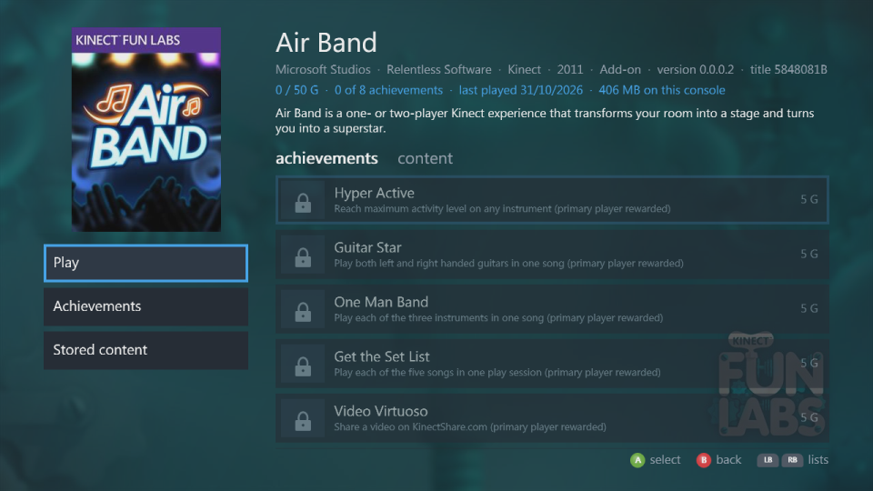
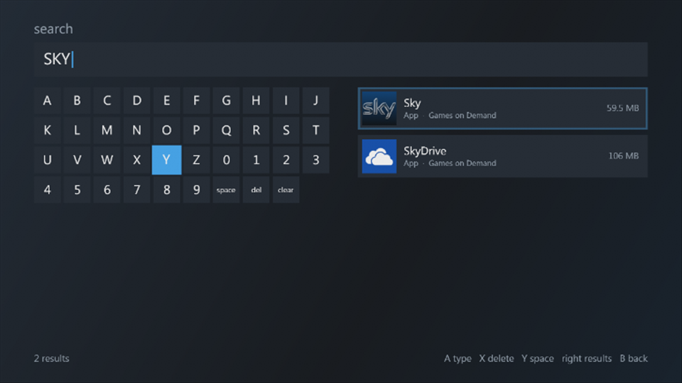
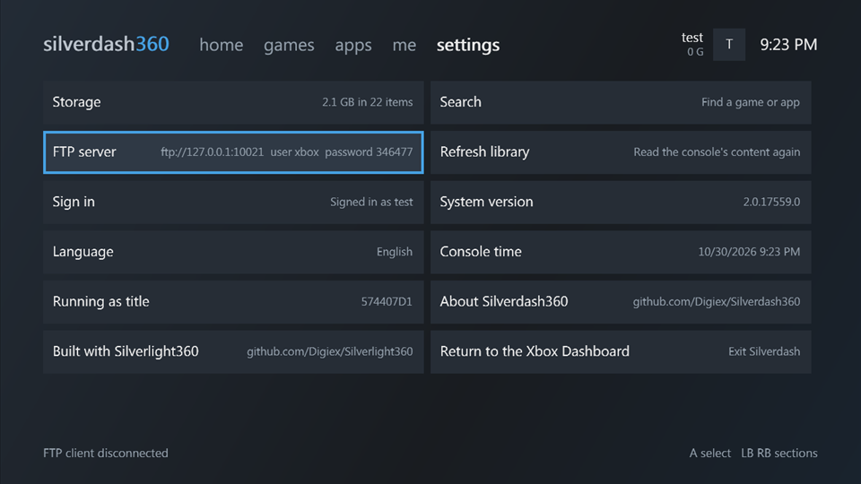

# Silverdash360

Silverdash360 is a dashboard for the Xbox 360: it lists the games and apps on your console, with their box art, and starts them. It also plays your music, videos and pictures, from the console's drives and from media servers on your network, and shares the console's drives over FTP. It's written in C# on the console's own Silverlight platform with [Silverlight360](https://github.com/Digiex/Silverlight360).

| | |
|---|---|
|  |  |
| Home: recently played and the apps | A shelf of covers |
|  |  |
| The same shelf as a list | A title's details, stored content and achievements |
|  |  |
| Search as you type | Settings |

## What it does

- **Games and apps**: everything installed on the hard drive and USB drives, Games on Demand, Arcade, Indie and demos, original Xbox games, and homebrew in `Apps` and `Games` folders, with box art and store details from the Xbox Marketplace. [Games and apps](games-and-apps.md)
- **Jump back in**: the titles you played last, and the disc in the drive, on the home page.
- **Media**: music, videos and pictures from the drives, data discs and DLNA media servers such as Plex, and the videos you downloaded from Xbox LIVE. [Media](media.md)
- **Your profile**: gamertag, gamerscore and achievements.
- **Themes**: the wallpapers of the console dashboard's themes, a section each. [Settings](settings.md#themes)
- **FTP server, file browser and storage**: the console's drives over the network, every file on them, and what takes the space. [Settings](settings.md)
- **Updates**: it tells you when there's a new version and installs it. [Updating](updating.md)

## Getting started

1. [Install it](install.md): it needs an Xbox 360 that runs homebrew, and the runtime from an Xbox 360 app you have.
2. Find your way around: [Getting around](getting-around.md) has the controls.
3. If something isn't right, see [Troubleshooting](troubleshooting.md).

Silverdash360 is made by [Digiex](https://digiex.net). Its source is on [GitHub](https://github.com/Digiex/Silverdash360); see [Development](development.md) for building it yourself.
