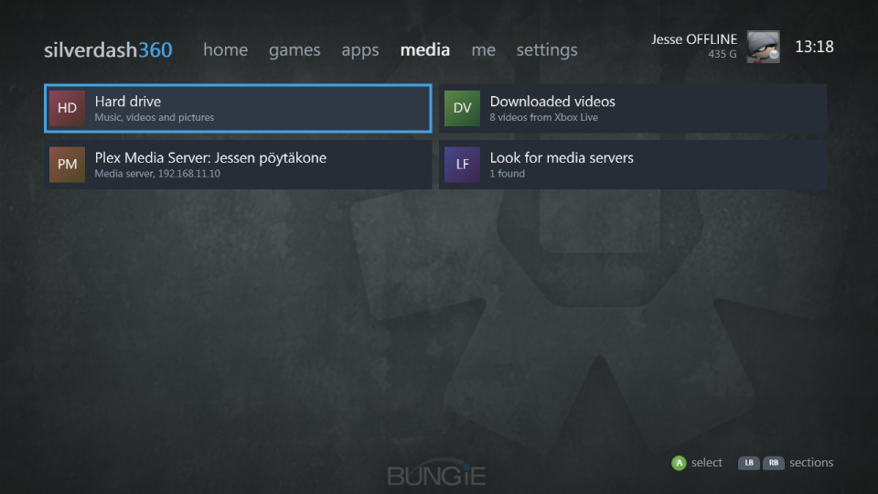

# Media

The **media** section lists where your music, videos and pictures are:

- **The drives**: the hard drive, USB drives and a data disc.
- **Media servers** on your network that share over DLNA, such as Windows Media Player, Plex and Kodi. They're looked for when you stay on the media section.
- **Downloaded videos**: the movies, TV and trailers you downloaded from Xbox LIVE, with their pictures. A video downloaded since the last **Refresh library** in settings shows after the next one.
- **Play disc**, with a DVD movie or a game in the drive.

A source opens as folders. LB and RB filter them: everything, music, videos or pictures.

## Playing

A on a song or a video plays it, and then the rest of its kind in the folder, with the console's own transport bar; X and Y go to the previous and next. Pictures go left and right, and A starts a slideshow.

## Formats

Silverdash360 plays what the console's player decodes: MP3, WMA and M4A (AAC) music, WMV, MP4, M4V and MOV (H.264) videos, and JPEG and PNG pictures. AAC and H.264 need the console's Optional Media Update, which the console installs the first time it's needed.

Files in other formats, such as MKV and AVI, are listed dimmed with their format, and aren't played. The console's own dashboard plays AVI, MPEG-2 and audio CDs with players of its own, which apps can't use.

## Media servers

A media server's files are played through Silverdash360, which fetches them for the console's player. If yours isn't listed:

- Check its DLNA sharing is on. In Plex it's **Settings, DLNA, Enable the DLNA server**.
- The console and the server need to be on the same network, and the network has to pass multicast, which some Wi-Fi setups block.
