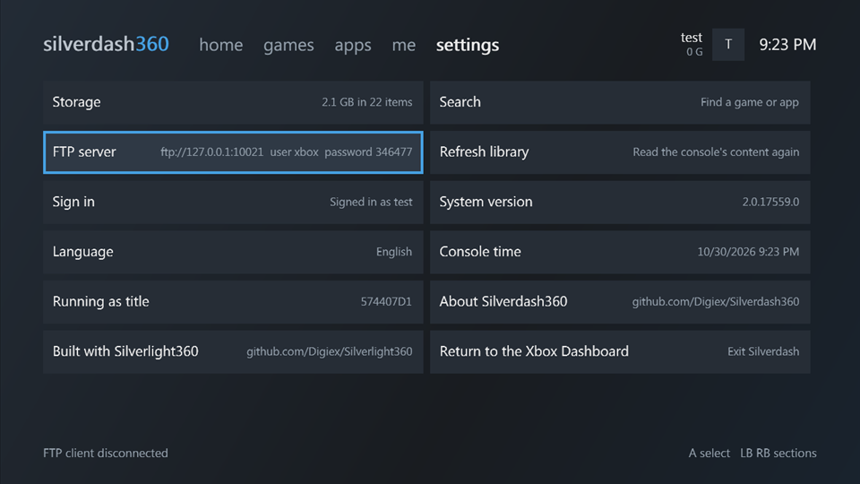
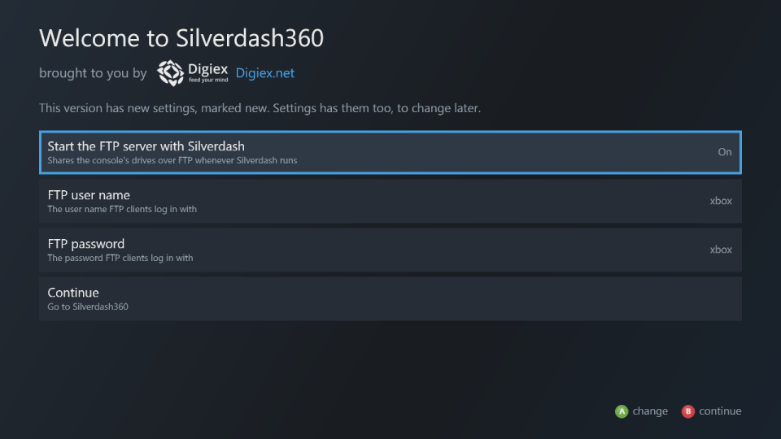
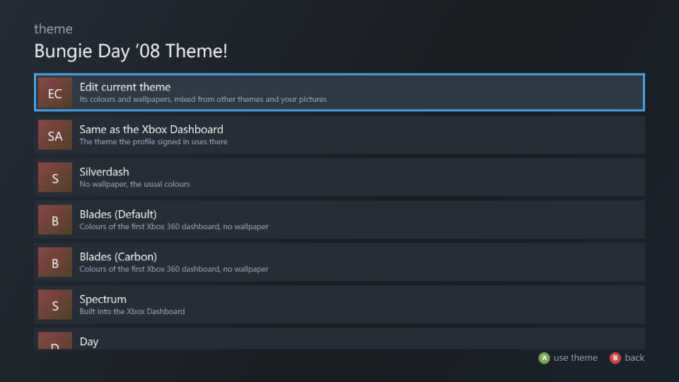
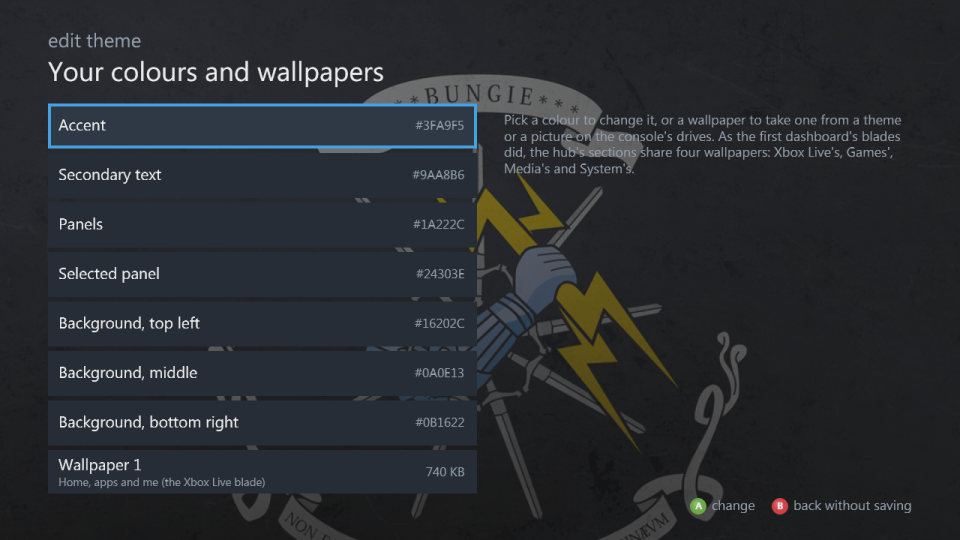
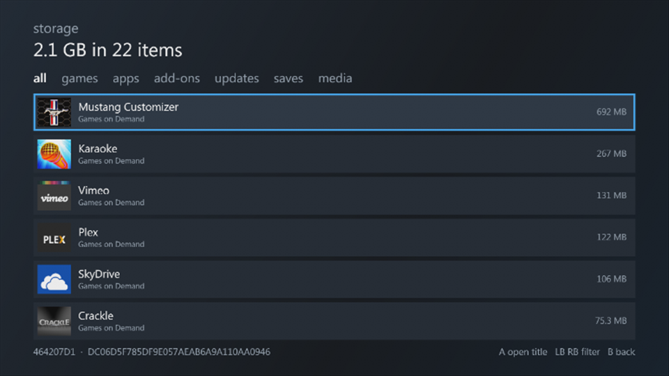

# Settings

| Setting | |
|---|---|
| **Theme** | The wallpapers and colours: see [Themes](#themes) |
| **Storage** | Everything stored, largest first |
| **Search** | Find a game or app |
| **File browser** | Every file on the console's drives |
| **FTP server** | The console's drives over the network, on or off now: see [FTP server](#ftp-server) |
| **Start the FTP server with Silverdash** | Starts it whenever Silverdash360 starts |
| **FTP user name**, **FTP password** | What FTP clients log in with |
| **Welcome screen** | The basic settings, as at the first start: see [Welcome screen](#welcome-screen) |
| **Refresh library** | Reads every package again, add-ons, saves and videos too, for when something is missing or out of date |
| **Sign in** | Signs a profile in |
| **System version**, **Language**, **Console time** | The console's |
| **Running as title**, **Running from** | The title ID Silverdash360 runs as, and its folder |
| **Version** | Silverdash360's version, build and commit |
| **Check for updates** | Looks for a new version: see [Updating](updating.md) |
| **XboxNGen** | Shown when Silverdash360's code runs compiled, as native code [XboxNGen](https://github.com/Digiex/Silverlight360-XboxNGen) made |
| **Return to the Xbox Dashboard** | Leaves Silverdash360 |
| **Debug server** | For testing and development, off unless you turn it on: see [Debug server](#debug-server). With it on, anyone on your network can control Silverdash360 |

## Welcome screen

The welcome screen, **Welcome to Silverdash360**, opens at the first start with the basic settings: whether the FTP server starts with Silverdash360 and, once it does, its user name and password. It opens again after an update that adds basic settings, with those marked **new**. Continue or B goes on to Silverdash360. **Welcome screen** in settings opens it any time.

## Themes

The theme follows the console dashboard's own by default (**Same as the Xbox Dashboard**), so your wallpapers come with you. **Theme** lists the themes built into the console's dashboard and those installed on the console; A uses one. Each profile keeps the theme it picked, and so does nobody signed in: signing out shows the one picked with nobody signed in, or Silverdash360's own colours if none was. The built-in themes (Spectrum, Day and Night) are read from the console's own dashboard files, so they're the ones your dashboard version has; the dashboard's Xbox 360 theme isn't among those files, so Silverdash360 shows its own colours for it. A theme's four wallpapers go to the sections as they went to the first dashboard's blades: the first (Xbox Live's) to home, apps and me, the second to games, the third to media and the fourth (System's) to settings. Its colours go to Silverdash360's. **Silverdash** is Silverdash360's own colours and no wallpaper. **Blades (Default)** and **Blades (Carbon)** are colours after the two styles of the first Xbox 360 dashboard, with no wallpaper; as its blades did, each section has a colour of its own: me is Xbox Live's orange, games green, media blue, apps the Marketplace blade's and settings the System blade's. Picture themes made in the Xbox Dashboard from your own pictures work too. If the dashboard's theme for your profile is a theme package that's no longer installed, such as one from an older dashboard, Silverdash360 shows its own colours and settings names the missing theme.

## Theme editor

**Edit current theme**, the first row of **Theme**, makes a theme of your own, starting from the one shown:

- **Colours**: the accent, secondary text, panels, the selected panel and the three colours of the background. A on one opens a grid of colours; the dashboard takes each on as you move, A keeps it and B puts the old one back.
- **Wallpapers 1 to 4**: for home, apps and me, for games, for media, and for settings, as a theme's are. A wallpaper can be none, a JPEG or PNG picture on the console's drives (up to 4 MB), or any wallpaper of the built-in and installed themes, shown behind the list as you pick.
- **Save** makes it the custom theme of the profile signed in (or of nobody signed in, when nobody is) and uses it. **Save for nobody signed in too** also keeps it for when nobody is signed in.
- **Save as...** asks for a name and keeps it in Silverdash360 for everyone on the console; it's listed in **Theme** under that name. X on a saved theme there, twice, deletes it.

B leaves without saving and puts the colours back. Once saved, **Custom theme** in the theme list picks it again; it's listed for a profile that has one, or for nobody signed in when there's one for nobody.

## Storage

Everything stored on the console, largest first, by kind: games, apps, add-ons, title updates, saves and media. LB and RB filter it. A opens the title a package belongs to. Add-ons and saves are as Silverdash360 last read them: when you opened their title's page, or at the last **Refresh library**.

## File browser

Every folder and file on the console's drives. A opens a folder, plays a song, video or picture, or starts a `.xex`. A content package shows its name and picture.

## FTP server

The FTP server shares the console's drives while Silverdash360 runs. **FTP server** turns it on and off with A, and shows the address, user name and password while it's on. With **Start the FTP server with Silverdash** on, it starts by itself each time.

The user name is `xbox` and the password six digits made up at the first start; both stay the same until you change them. A on **FTP user name** or **FTP password** opens the console's keyboard to change it.

- Connect with plain FTP, such as FileZilla with **Only use plain FTP**; there's no TLS.
- Each drive is a folder: `Hdd1`, `Usb0` to `Usb2`, `Mu0`, `Mu1` and `Dvd` (read only).
- You can download, upload, rename and delete, and make and remove folders.
- FTP sends the password unencrypted, so use it on a network you trust.

## Debug server

**Debug server**, the last setting, turns on a TCP port (4601) that takes commands from a PC: what tests, `tools\deploy.py` and the other tools in the [repository](https://github.com/Digiex/Silverdash360) use (see [Debug server and tests](development.md#debug-server-and-tests)). A turns it on and off at once, and it stays as you left it the next time Silverdash360 starts. It's off unless you turn it on; builds made for testing have it on.

**It has no password.** While it's on, anyone on your network can control Silverdash360, read the files on the console's drives and start programs. Leave it off unless you're testing or developing, and then use it on a network you trust.
